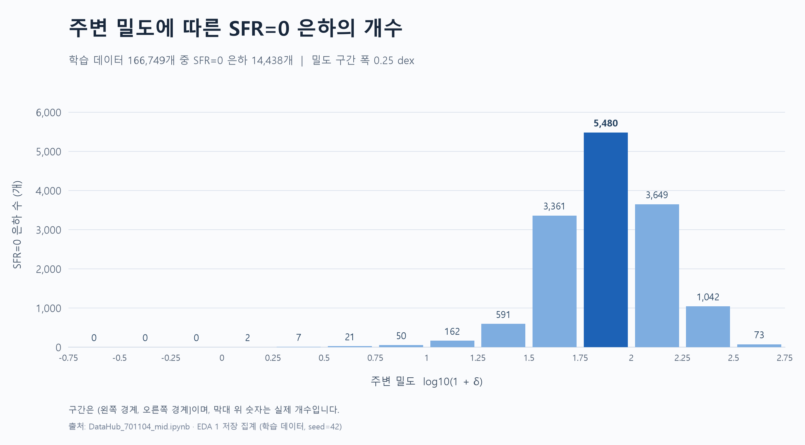
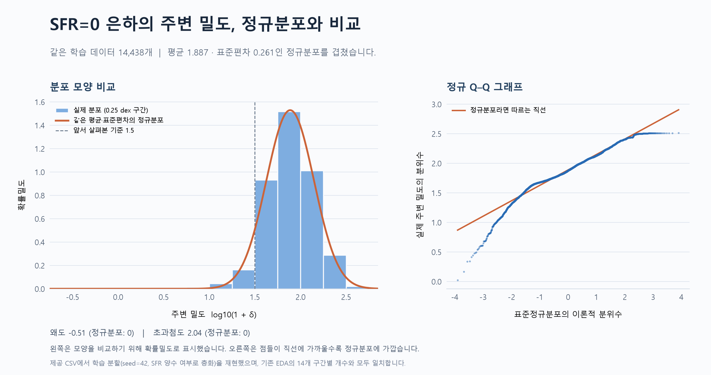
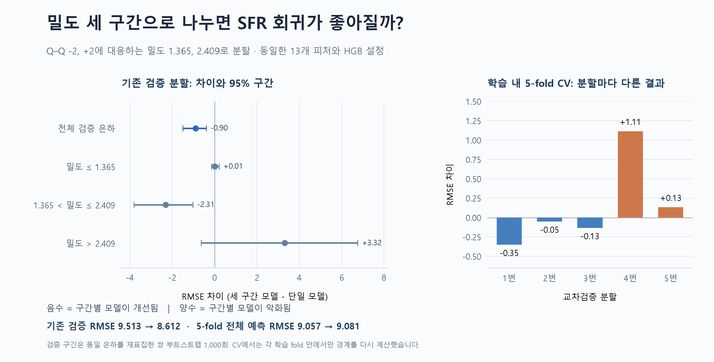
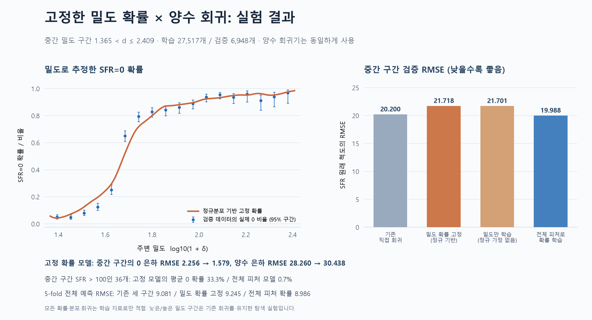
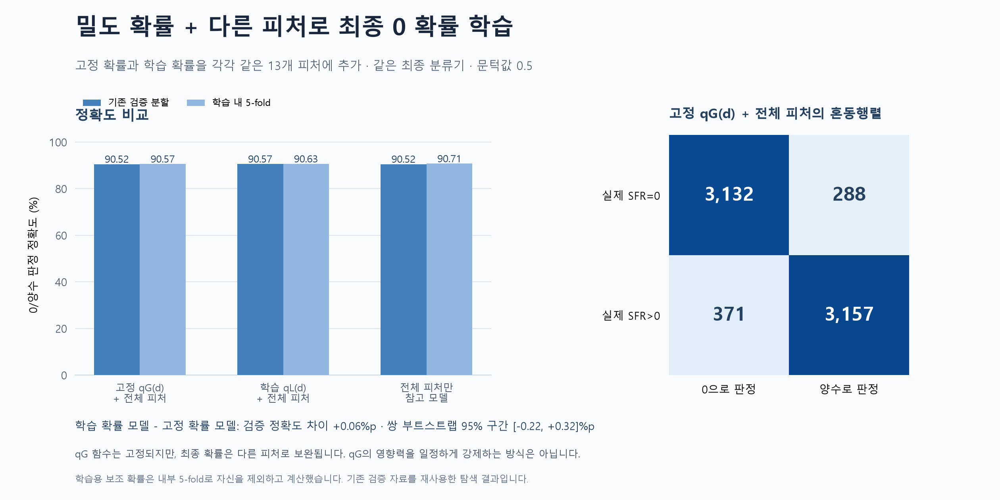

# 2026년 11월 6일 밀도와 SFR 실험 정리

주변 밀도로 SFR=0 은하를 설명하고, 별 생성의 유무와 양수일 때의 크기를 나누어 예측하는 구조를 검토했다. 마지막으로 확인한 구조는 **밀도에서 얻은 확률 함수를 고정하고, 그 확률과 다른 피처를 함께 입력해 최종 0일 확률을 학습하는 모델**이다.

이 구조의 중간 구간 검증 정확도는 **90.52%**였다. 밀도 확률의 정규분포 가정을 풀어 같은 방식으로 결합한 모델은 **90.57%**였으며, 차이를 확인할 근거는 부족했다. 정규분포 모양은 EDA 결과로 보존하되, 세 구간 분할과 정규분포 가정을 최종 모델의 필수 요소로 확정하지 않았다. 오늘의 분류 결과는 SFR 크기까지 출력하는 최종 모델의 성능과 구분한다.

## 공통 데이터와 검증 조건

- 원자료: 저장소 루트의 제공 CSV 208,437행.
- 타깃: 원래 척도의 `sfr_linear`. 0의 정의는 제공된 값이 정확히 0인 경우다.
- 입력: 식별자 `subhalo_id`와 타깃을 제외한 13개 피처. 주변 밀도 `log10_overdensity_plus_1`도 포함한다.
- 기존 노트북과 동일한 80:20 분할: 학습 166,749개, 검증 41,688개, `random_state=42`, SFR 양수 여부로 층화.
- 추가 비교는 학습 안의 5-fold CV로 수행했다. 각 외부 fold의 경계와 모델은 해당 fold의 학습 자료로 다시 추정했다.
- 0 분류의 양성 클래스는 **SFR=0**이다. 모든 기본 판정은 최종 0일 확률이 0.5 이상이면 0, 그 외에는 양수다.
- 오늘은 기존 검증 자료를 여러 번 확인했다. 아래 결과는 탐색 결과이며, 새로운 최종 테스트 성능으로 취급하지 않는다. 행 단위 부트스트랩은 은하 간 독립을 가정하고 적합된 모델을 조건으로 한다.

## 주변 밀도의 분포

밀도 변수는 아래에서 d로 표기한다. 다음 관찰은 **SFR=0인 은하의 d 분포**에 관한 것이며, 전체 은하의 밀도 분포나 SFR 자체의 정규성을 뜻하지 않는다.

### 개수와 비율

학습 은하 중 SFR=0은 14,438개다. 기존 EDA와 같은 폭 0.25 dex 구간을 사용했다. 개수는 밀도 (1.75, 2.00]에서 5,480개로 가장 많았다. 더 높은 밀도에서 개수가 줄어드는 것은 구간의 전체 표본 수가 적기 때문이며, 0의 비율은 계속 높아진다.



### 정규분포와의 비교

SFR=0 학습 은하 전체의 밀도 평균은 **1.886658**, 표준편차는 **0.260954**다. 중심부는 정규분포와 비슷하지만, Q–Q 그래프의 양 끝에서는 벗어난다. 왜도는 -0.512, 초과첨도는 2.041이다. 낮은 밀도 쪽 꼬리가 길고 높은 쪽 극단 분위수는 기준 정규분포보다 짧다.



### 세 구간 경계

기준 정규분포의 평균 ± 2표준편차로 다음 탐색적 경계를 정했다.

$$
L=1.3647506592,\qquad U=2.4085653980.
$$

Q–Q 가로축의 -2와 +2를 **기준 정규분포에서** 밀도로 환산한 값이다. 관측 Q–Q 곡선에서 실제로 꺾이는 위치를 최적화한 결과나, 문헌에서 주어진 물리적 임계값은 아니다.

| 구간 | 학습 은하 | 학습 SFR=0 | 0 비율 | 검증 은하 |
|---|---:|---:|---:|---:|
| 낮음 d ≤ L | 138,928 | 435 | 0.31% | 34,664 |
| 중간 L < d ≤ U | 27,517 | 13,702 | 49.79% | 6,948 |
| 높음 d > U | 304 | 301 | 99.01% | 76 |

최고 밀도 구간에는 양수 SFR이 학습 3개, 검증 1개뿐이다. 밀도의 극단값과 SFR의 극단값은 서로 다른 구분이다. 고밀도 집단의 대부분은 SFR=0이다.

## 세 구간 회귀

기존 HGB 설정을 유지하고, 밀도 세 구간마다 독립 회귀기를 학습했다. 기존 두 단계 모델도 참고용으로 재현했다.

| 회귀 구조 | 전체 검증 RMSE | 학습 5-fold 전체 예측 RMSE |
|---|---:|---:|
| 전체 단일 HGB | 9.513 | 9.057 |
| 세 구간 독립 HGB | 8.612 | 9.081 |

단일 검증에서는 개선됐고, 차이의 쌍 부트스트랩 95% 구간은 [-1.496, -0.392]였다. 그러나 CV의 fold별 차이는 -0.349, -0.050, -0.133, +1.114, +0.133으로 방향이 섞였다. 안정적인 RMSE 개선은 확인되지 않았다.

구간별 검증 RMSE는 낮음 2.696→2.708, 중간 22.510→20.200, 높음 2.775→6.093이었다. 중간의 개선을 그 구간의 회귀가 충분히 정확하다는 뜻으로 해석하지 않는다. 기본 `early_stopping='auto'`는 표본 수에 따라 다르게 작동하므로 분할과 학습량 효과도 완전히 분리하지 못했다.



원수치: [회귀 결과 JSON](density_exploration_2026-11-06/density_segment_regression_results.json), [구간별 집계](density_exploration_2026-11-06/density_segment_group_sizes.csv).

## 밀도 확률을 만드는 식

밀도 확률은 정규곡선의 높이를 그대로 확률로 사용한 값이 아니다. 중간 구간에서 두 클래스의 밀도 분포를 비교하는 베이즈 사후확률이다.

$$
q_G(d)=P(Y=0\mid d)
=\frac{\pi_0 f_0(d)}{\pi_0 f_0(d)+(1-\pi_0)f_+(d)}.
$$

- 중간 구간의 학습 0 비율: π₀ = 0.497946724.
- f₀는 [L,U]로 제한한 절단정규분포다. 적합된 위치 모수는 1.899230509, 척도 모수는 0.229778511이다.
- f₊는 양수 학습 은하 13,815개의 밀도에 대한 Gaussian KDE다. Scott 대역폭을 사용했고 실제 커널 표준편차는 0.022604506이다. 중간 구간 안에서 면적이 1이 되도록 정규화했다.
- f₀의 정규화 상수는 0.976668418, f₊의 정규화 상수는 0.965723407이다.

평균 1.886658과 표준편차 0.260954는 **전체 0 집단을 요약하고 경계를 정한 값**이다. 위치 1.899231과 척도 0.229779는 **중간의 절단정규분포를 적합한 모수**이므로 서로 다른 값이다.

현재 q_G는 양수 쪽에 KDE를 사용한다. 전체 확률 함수가 두 모수만 가진 순수 정규분포 모형인 것은 아니다.

## 고정 확률과 양수 회귀의 곱

먼저 q_G를 고정하고, 양수 학습 은하만으로 13개 피처를 사용한 회귀 m₊를 학습한 뒤 아래처럼 곱했다.

$$
\hat Y=[1-q_G(d)]m_+(X).
$$

확률을 밀도만으로 계산했어도 **회귀에는 다른 피처를 모두 사용했다**. 중간 구간만 새 방식으로 교체하고 낮음과 높음은 기존 세 구간 회귀를 유지했다.

이 곱을 전체 X에 대한 정확한 조건부 기댓값으로 해석하려면, 밀도를 알고 난 뒤 다른 피처가 0 여부에 추가 정보를 주지 않는다는 가정이 필요하다. 일반적인 기댓값 분해에는 P(Y=0 | X)가 들어간다.

| 구조 | 중간 검증 RMSE | 전체 검증 RMSE | 5-fold 전체 예측 RMSE |
|---|---:|---:|---:|
| 기존 세 구간 직접 회귀 | 20.200 | 8.612 | 9.081 |
| 고정 밀도 확률 × 양수 회귀 | 21.718 | 9.207 | 9.245 |
| 전체 피처 분류 확률 × 같은 양수 회귀 | 19.988 | 8.529 | 8.986 |

고정 밀도 확률을 곱하면 중간의 0 은하 RMSE는 2.256→1.579로 줄었지만, 양수 은하 RMSE는 28.260→30.438로 커졌다. SFR>100인 검증 36개의 양수 회귀 출력 평균은 101.04였고, 밀도 확률을 곱한 뒤 66.54가 됐다. 실제 평균은 282.84였다.

이 36개에 대한 평균 0 확률은 밀도만 쓰면 33.3%, 전체 피처를 사용하면 0.7%였다. 밀도별 평균적인 확률이 다른 피처로 구분되는 개별 은하의 확률을 대신하면서, 큰 양수 예측을 추가로 낮춘 것으로 해석할 수 있다. 정규 가정 없이 밀도만 학습한 확률도 유사한 결과였다.

이 회귀기는 양수 표본의 오차를 최소화하도록 먼저 학습하고 마지막에 확률을 곱했다. 곱까지 포함한 최종 오차를 최소화하는 공동 학습 실험은 아니다. 전체 피처 확률을 사용한 작은 개선도 현재 검증만으로 확정하지 않는다.



원수치: [곱셈 회귀 결과 JSON](density_exploration_2026-11-06/fixed_density_hurdle_results.json).

## 0 여부만 분류한 비교

다음은 회귀 없이 0/양수 상태만 판정한 별도 실험이다. 정확도와 오류율은 **전체 41,688개가 아닌 중간 검증 6,948개** 기준이다. 0일 확률이 0.5 이상이면 0으로 판정했다.

| 0 분류 구조 | 검증 정확도 | 0 정밀도 | 0 재현율 | 5-fold 정확도 |
|---|---:|---:|---:|---:|
| 밀도 함수 q_G만 사용 | 85.97% | 85.57% | 85.99% | 86.12% |
| 밀도만으로 q_L을 자유롭게 학습 | 86.80% | 84.24% | 90.03% | 86.81% |
| 전체 13개 피처로 처음부터 학습 | 90.52% | 89.50% | 91.46% | 90.71% |

첫 행은 975개를 오판정했다. 실제 0을 양수로 판정한 경우는 479개, 실제 양수를 0으로 판정한 경우는 496개다. 밀도 함수만 자유롭게 바꾼 두 번째 행은 전체 오류를 줄였지만, 양수를 0으로 잘못 보낸 수는 576개로 늘었다.

이 세 행은 아래의 최종 결합 실험과 다른 비교다. 특히 **85.97%→86.80%를 다른 피처를 함께 사용하는 모델에서 정규 가정을 풀어 얻은 개선으로 해석하면 안 된다**.

문턱값을 높인 고정 밀도 함수의 결과는 다음과 같다. 확률이 0.95 이상이라는 조건이 실제 0 정밀도 95%를 보장하지 않는다.

| 문턱값 | 0 정밀도 | 0 재현율 |
|---|---:|---:|
| 0.5 | 85.57% | 85.99% |
| 0.8 | 90.06% | 62.25% |
| 0.9 | 93.72% | 34.06% |
| 0.95 | 94.15% | 11.29% |

원수치: [고정 밀도 분류](fixed_density_zero_classifier_results/metrics.json), [학습 분류 비교](learned_zero_classifier_results/metrics.json).

## 고정 밀도 확률과 다른 피처의 최종 결합

오늘 최종적으로 확인하려던 구조는 다음 두 모델이다.

$$
\hat p_{0,G}(X)=G_G\bigl(X,q_G(d)\bigr),\qquad
\hat p_{0,L}(X)=G_L\bigl(X,q_L(d)\bigr).
$$

두 모델 모두 같은 13개 원래 피처와 밀도 확률 하나를 입력받는다. q_G는 정규분포 기반 함수로 적합 후 고정하고, q_L은 밀도만 사용한 HGB로 형태를 자유롭게 학습한다. 같은 설정의 최종 HGB 분류기가 다른 피처와 결합해 전체 정보를 알 때의 확률을 학습한다.

학습용 보조 확률은 내부 5-fold로 각 행을 제외한 자료에서 계산했다. 각 외부 CV fold에서도 이 과정을 다시 수행했다. 검증에서는 전체 학습 자료로 적합한 밀도 함수를 사용했다. 두 주 비교 모델의 입력 차원은 모두 14개다.

| 최종 분류 구조 | 검증 정확도 | 0 정밀도 | 0 재현율 | 5-fold 정확도 |
|---|---:|---:|---:|---:|
| 고정 q_G + 전체 피처 | 90.52% | 89.41% | 91.58% | 90.57% |
| 학습 q_L + 전체 피처 | 90.57% | 89.56% | 91.52% | 90.63% |
| 보조 확률 없이 전체 피처만 사용 | 90.52% | 89.50% | 91.46% | 90.71% |

학습 q_L과 고정 q_G 모델의 정확도 차이는 +0.0576%p, 검증 6,948개 중 순수하게 4개를 더 맞힌 차이다. 쌍 부트스트랩 95% 구간은 [-0.216, +0.317]%p, 정확 McNemar 검정 p값은 0.757이었다. 이 비교에서는 정규 가정을 풀어 얻는 차이를 확인하지 못했다.

고정 q_G 결합 모델의 혼동행렬은 다음과 같다.

| 실제 상태 | 0으로 판정 | 양수로 판정 |
|---|---:|---:|
| SFR=0 | 3,132 | 288 |
| SFR>0 | 371 | 3,157 |

중간 검증의 SFR>100인 36개는 두 결합 모델 모두 양수로 판정했다. 이 표본에서의 결과이며 앞으로의 극단값에서 오판정이 없다는 보장은 아니다.



**고정한 것은 q_G의 함수와 모수다. 그 영향력을 최종 모델에 강제한 것은 아니다.** G는 q_G를 보조 피처로 사용하거나 무시할 수 있고, 원래 밀도도 입력에 포함된다. q_G는 기존 밀도를 변환한 값이므로 새로운 관측 정보를 추가하지 않는다. 이 실험만으로 모든 정규분포 기반 구조가 불필요하다고 결론 내리지 않는다.

원수치: [최종 결합 비교 JSON](density_probability_with_features_results/metrics.json), [비교표 CSV](density_probability_with_features_results/comparison.csv).

## 목적과 정당화

분석의 과학적 질문은 **은하의 주어진 특성으로 별 생성의 유무와 강도를 얼마나 예측할 수 있고, 각 정보가 어느 부분에서 설명력을 갖는가**다.

[원본 템플릿](../../DataHub_Midterm_Final_Report_Template.ipynb)의 `FINAL_SCORE`는 전체 검증 RMSE로 계산한다. 동시에 11절은 0/양수/높은 SFR의 오류 분석, 12절은 천체물리적 해석, 14절은 재현성을 필수로 요구한다. 공식 심사 배점표는 확인하지 못했으므로 보고서와 RMSE의 배점을 추정하지 않는다.

참확률과 조건부 평균을 안다면 RMSE에 맞는 예측은 아래 기댓값이다.

$$
E[Y\mid X]=P(Y>0\mid X)E[Y\mid Y>0,X].
$$

반면 최종 확률을 문턱값으로 잘라 0을 출력하는 방식은 상태 판정의 목적과 오류 비용에 관한 선택이다. 정확히 0을 출력해야 한다는 결론이 기댓값 분해에서 자동으로 나오지는 않는다. 오늘은 분류기의 0 정밀도와 재현율을 검증했으며, 이 최종 분류기와 회귀를 연결한 하드 분기의 전체 SFR RMSE는 새로 평가하지 않았다.

환경에 의한 별 생성 억제는 밀도를 살펴볼 물리적 동기다. 그러나 밀도와 0의 연관, Q–Q의 이탈, 예측 성능 차이만으로 인과관계나 세 개의 물리적 집단을 입증하지 않는다. 원자료의 밀도 정의와 0 값의 계산 방식 확인도 물리적 해석에 필요하다.

## 정규분포 관찰의 활용

이번 보조 피처 방식에서는 정규 가정의 추가 예측 이점을 확인하지 못했다. 분포 관찰은 다음 질문의 기준 모형으로 보존한다.

- 낮은 밀도에서 SFR=0인 학습 은하 435개는 중심부 은하와 질량·블랙홀·병합 정보가 어떻게 다른가.
- 항성 질량별로 나눠도 중심부의 정규분포 같은 모양이 유지되는가. 평균과 폭은 어떻게 달라지는가.
- 더 간단한 분포 모형이 유연한 모형과 가까운 예측력을 유지하는가.

정규분포의 로그 밀도는 표준화 거리의 제곱으로 표현된다. 두 클래스의 밀도가 모두 정규분포라면 로그 사후 오즈가 밀도의 이차식이 되고, 두 분산이 같으면 선형식이 된다. 현재는 양수 집단의 정규성이 확인되지 않아 이 전제를 적용하지 않았다.

추가 후보로 아래처럼 고정 기준 오즈에 다른 피처의 보정을 더하는 offset 구조를 논의했다.

$$
\operatorname{logit}p_0(X)=\operatorname{logit}q_G(d)+h(Z).
$$

이는 보조 피처로 넣었던 오늘의 최종 결합과 다른 모델이다. 계수 1의 기준 항과 복잡도를 제한한 보정이라는 새로운 제약이 들어가며, **아직 구현하거나 검증하지 않았다**. 정규성 자체가 예측력 향상을 보장하는 것은 아니다.

관련 근거: [Peng 외 2010](https://arxiv.org/abs/1003.4747), [Wetzel 외 2015](https://arxiv.org/abs/1503.06799), [가우시안 판별분석](https://scikit-learn.org/stable/modules/lda_qda.html), [GLM offset](https://www.statsmodels.org/dev/generated/statsmodels.genmod.generalized_linear_model.GLM).

## 코드와 재실행

실행 환경은 Python 3.12였다. 주요 라이브러리 버전은 [requirements_2026-11-06.txt](requirements_2026-11-06.txt)에 고정했다. 저장한 joblib 모델은 해당 버전과 함께 사용한다.

저장소 루트에서 실행한다. 별도 패키지 경로를 쓰는 환경은 `SFR_ANALYSIS_DEPENDENCIES`에 그 경로를 지정할 수 있다. 플롯의 한글 글꼴은 Windows의 Malgun Gothic을 사용한다.

```powershell
python -m pip install -r work/조장/requirements_2026-11-06.txt

# EDA와 초기 회귀 실험을 순서대로 재현
python work/조장/density_exploration_2026-11-06/plot_zero_sfr_counts.py
python work/조장/density_exploration_2026-11-06/compare_zero_sfr_normal.py
python work/조장/density_exploration_2026-11-06/density_segment_regression.py
python work/조장/density_exploration_2026-11-06/plot_density_segment_results.py
python work/조장/density_exploration_2026-11-06/fixed_density_hurdle_experiment.py
python work/조장/density_exploration_2026-11-06/plot_fixed_density_hurdle.py

# 분류 실험과 최종 확률 결합을 순서대로 재현
python work/조장/fixed_density_zero_classifier.py
python work/조장/learned_zero_classifier.py
python work/조장/density_probability_with_features.py
```

| 파일 | 역할 |
|---|---|
| [초기 탐색 폴더](density_exploration_2026-11-06/) | 개수 그래프, 정규분포 비교, 세 구간 회귀, 확률 곱셈 실험과 원수치 |
| [고정 밀도 분류 코드](fixed_density_zero_classifier.py) | q_G 함수와 밀도만 사용한 0 판정, 저장과 재로딩 |
| [학습 분류 비교 코드](learned_zero_classifier.py) | 밀도만 학습한 함수와 전체 피처 분류 비교 |
| [최종 결합 코드](density_probability_with_features.py) | 고정 q_G 또는 학습 q_L을 전체 피처와 결합한 동일 조건 비교 |
| 각 `*_results/metrics.json` | 계수, 지표, fold 결과, 검증 조건과 한계 |
| 각 `*_results/validation_predictions.csv` | 검증 행별 확률과 판정 결과 |

오늘 작업은 조장 폴더의 독립 실험과 기록으로 남겼다. 제출 노트북과 기존 `FINAL_MODEL`은 변경하지 않았다.
