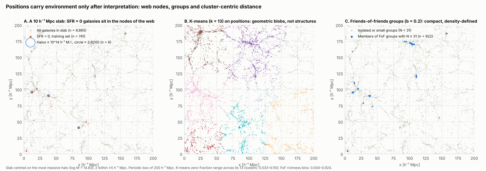
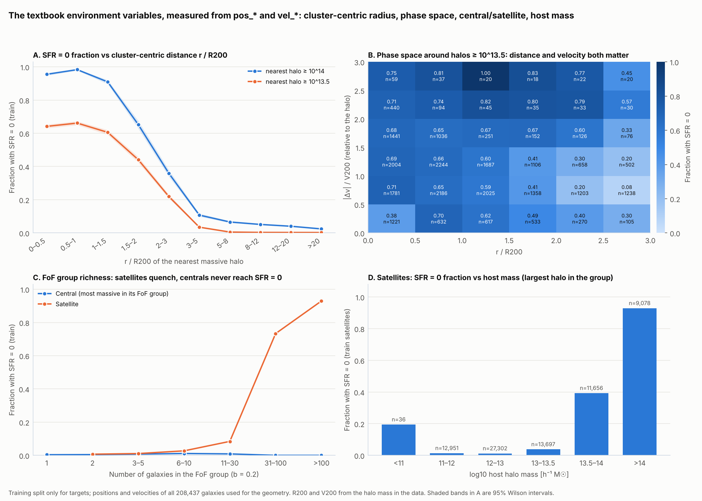
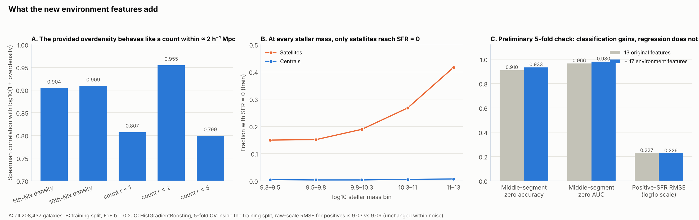

# 2026년 11월 7일 위치·속도에서 환경을 읽는 이론과 EDA

제출 노트북의 `FINAL_MODEL`은 `pos_x, pos_y, pos_z, vel_x, vel_y, vel_z`를 상자 좌표 그대로 입력받았고, 이 6열은 빼도 성능이 같았다. 좌표 자체는 은하의 성질이 아니기 때문이다. 천문학에는 위치와 속도를 "환경"으로 바꾸는 표준 정의가 있고, 이 문서는 그 정의를 정리한 뒤 우리 데이터에 적용해 SFR=0과의 관계를 본 EDA다. 피처 구현은 이 문서를 바탕으로 따로 한다.

결론 요약.

- **환경의 정체는 "위성인가, 호스트가 얼마나 무거운가"다.** FoF 그룹에서 가장 무거운 은하(중심)는 항성 질량과 무관하게 0.4~0.7%만 SFR=0이고, 위성은 15%에서 42%까지 올라간다. 위성의 0 비율은 호스트 헤일로 질량 10^13.5 근처에서 4%에서 39%로, 10^14 이상에서 93%로 뛴다.
- **은하단 중심 거리**로 보면 r/R200 < 1.5에서 91~98%가 0이고, 1.5~3 R200에서 65%에서 36%로 떨어지며, 5 R200 밖에서는 7% 이하다. 같은 거리에서는 호스트 대비 상대 속도가 빠른 쪽이 더 많이 0이다.
- **제공된 밀도는 약 2 h⁻¹ Mpc 안의 이웃 수와 거의 같다**(Spearman 0.955). 그 척도보다 작은 그룹의 위성은 제공 밀도로는 보이지 않고, 어제 설명하지 못한 낮은 밀도의 0 은하 435개는 **94%가 FoF 위성**이었다.
- **K-means는 환경을 찾지 못한다.** 위치를 13개로 나누면 군집별 0 비율이 3~15%에 머물고 군집으로 0을 가르는 AUC가 0.62다. 같은 위치에서 FoF 그룹 크기는 AUC 0.96이다. 구조를 나누는 도구는 밀도 기반(FoF, DBSCAN)이어야 하고, 나눈 결과는 모델을 쪼개는 데가 아니라 피처로 쓰는 것이 맞다.
- **예비 신호 확인**(학습 분할 안 5-fold): 중간 밀도 구간의 0 분류 정확도 90.98% → 93.34%, AUC 0.9655 → 0.9803. 양수 회귀 RMSE는 원척도 9.03 → 9.09, log1p 척도 0.2272 → 0.2258로 변화 없음. 환경은 "0인가"를 가르고 "얼마나 큰가"는 가르지 않는다는 어제·오늘의 그림과 일치한다.

수치는 학습 분할(166,749개) 타깃 기준이고, 기하 계산에는 208,437개 전체의 위치·속도를 썼다(타깃 미사용). 그림 글자는 영어다.

## 이론: 환경을 재는 표준 방법

### 어떤 척도의 환경인가

Muldrew 외 2012는 20여 가지 환경 측정법을 비교해 두 부류로 나눴다. **k번째 이웃 거리 방식**(Dressler 1980의 Σ_k)은 헤일로 안쪽의 밀도를 재고, **고정 반경 개수 방식**은 헤일로보다 큰 척도를 잰다. 두 방식은 서로 다른 물리를 보므로 하나로 다른 하나를 대신할 수 없다. 3차원에서는 다음을 쓴다.

$$
\rho_k = \frac{k}{\tfrac{4}{3}\pi d_k^3},\qquad N(<r) = \#\{\text{이웃}: |\mathbf{x}_j-\mathbf{x}_i| < r\}.
$$

Haas 외 2012는 시뮬레이션에서 환경 측정값이 결국 **호스트 헤일로 질량**의 대리 변수임을 보였다. 그래서 가장 직접적인 환경 변수는 "어느 헤일로에 속해 있고 그 헤일로가 얼마나 무거운가"다.

### 중심과 위성, 호스트 질량

Peng 외 2012와 Wetzel 외 2012는 환경 퀜칭이 사실상 **위성 퀜칭**임을 보였다. 중심 은하는 환경과 거의 무관하고, 위성의 퀜칭 비율은 호스트 헤일로 질량이 클수록, 중심에 가까울수록 높다. Wetzel 외 2013은 낙하 후 2~4 Gyr 지연 뒤 급속히 퀜칭되는 모형을 제안했다.

그룹을 찾는 표준 도구는 **friends-of-friends**(Davis 외 1985)다. 평균 입자 간격의 b = 0.2배 안에 있는 점들을 이어 붙인다. 우리 데이터의 평균 간격은 200/208437^{1/3} = 3.37 h⁻¹ Mpc이므로 연결 길이는 0.675 h⁻¹ Mpc다. 그룹 안에서 헤일로 질량이 가장 큰 은하를 중심, 나머지를 위성으로 둔다.

### 은하단 중심 거리와 위상공간

가장 무거운 헤일로를 기준으로 중심 거리를 R200으로 나눈 r/R200, 상대 속도를 V200으로 나눈 |Δv|/V200이 표준 좌표다.

$$
R_{200}=\left(\frac{3M}{4\pi\cdot 200\,\rho_{\rm crit}}\right)^{1/3},\qquad
V_{200}=\sqrt{\frac{GM}{R_{200}}}.
$$

Gómez 외 2003은 SFR이 R_vir의 2~3배 안쪽에서부터 떨어진다고 보고했고, Oman 외 2013과 Rhee 외 2017은 (r/R200, |Δv|/V200) 위상공간의 위치가 낙하 시점을 가른다고 보였다. 한 번 중심을 지나 다시 나온 은하(backsplash)는 R200 밖에서도 퀜칭돼 있다. 램 압력은 ρ v²에 비례하므로(Gunn & Gott 1972) 호스트 대비 속도가 필요하며, 상자 기준 속도는 그 대리 변수일 뿐이다.

### 우주 거대구조 분류와 K-means

우주 거대구조는 밀도장의 헤시안(T-web, Hahn 외 2007)이나 모스 이론(DisPerSE, Sousbie 2011)으로 마디·필라멘트·벽·보이드로 나눈다. 필라멘트 안에서도 퀜칭 비율이 다르다(Kraljic 외 2018). K-means는 거리 제곱합을 최소화해 공간을 비슷한 크기의 볼록 조각으로 나누므로, 균일하게 깔린 20만 개 점에서는 밀도와 무관한 기하학적 분할이 나온다. 구조를 찾으려면 밀도 기반 연결(FoF, DBSCAN)이어야 한다.

## EDA 결과

### 제공 밀도의 척도

| 후보 측정 | 제공 밀도와 Spearman | 단독으로 0을 가르는 AUC (학습) |
|---|---:|---:|
| 5번째 이웃 밀도 | 0.904 | 0.913 |
| 10번째 이웃 밀도 | 0.909 | 0.950 |
| r < 1 h⁻¹ Mpc 이웃 수 | 0.807 | 0.963 |
| **r < 2 h⁻¹ Mpc 이웃 수** | **0.955** | 0.983 |
| r < 5 h⁻¹ Mpc 이웃 수 | 0.799 | 0.946 |
| 제공 밀도 | – | 0.987 |

제공 밀도는 2 h⁻¹ Mpc 정도의 고정 반경 측정에 가깝다. 정의가 공개되지 않았으므로 추정이다.

### 은하단 중심 거리

가장 가까운 10^14 h⁻¹ M☉ 이상 헤일로(133개, R200 0.76~1.42 h⁻¹ Mpc)까지의 거리다.

| r/R200 | 학습 은하 | 0 비율 |
|---|---:|---:|
| 0~0.5 | 2,895 | 95.5% |
| 0.5~1 | 2,684 | 98.3% |
| 1~1.5 | 2,062 | 90.9% |
| 1.5~2 | 1,543 | 65.3% |
| 2~3 | 2,120 | 35.9% |
| 3~5 | 4,088 | 10.7% |
| 5~8 | 8,146 | 6.6% |
| 8~20 | 49,711 | 4.3% |
| > 20 | 93,500 | 2.4% |

R200 안에서는 거의 전부 0이고 1.5~3 R200이 전환 영역이다. 문헌의 "R_vir 2~3배 안에서 SFR 하락"과 같은 모양이다. R200 안 은하의 |Δv|/V200 중앙값이 1.09라서 속도 단위는 km/s로 보인다. 2 R200 안에서 상대 속도 0~0.5 V200은 82%, 1.5~2 V200은 97%가 0이라 같은 거리에서도 속도가 정보를 더한다.

### FoF 그룹: 중심과 위성

| 그룹 크기 N | 전체 | 중심 | 위성 |
|---|---:|---:|---:|
| 1 (고립) | 0.4% | 0.4% | – |
| 2 | 0.6% | 0.4% | 0.7% |
| 3~5 | 1.0% | 0.8% | 1.1% |
| 6~10 | 2.5% | 1.1% | 2.7% |
| 11~30 | 7.9% | 0.9% | 8.4% |
| 31~100 | 71.8% | 0.0% (242개) | 73.3% |
| > 100 | 92.4% | 0.0% (25개) | 92.9% |

| 항성 질량 | 중심 0 비율 | 위성 0 비율 |
|---|---:|---:|
| 9.3~9.5 | 0.44% | 15.0% |
| 9.5~9.8 | 0.35% | 15.1% |
| 9.8~10.3 | 0.35% | 18.9% |
| 10.3~11 | 0.54% | 26.8% |
| 11~13 | 0.71% | 41.6% |

중심 은하는 어떤 질량에서도 0이 되지 않는다. 이것이 오늘 앞서 본 "질량 퀜칭은 0이 아니라 낮은 sSFR"의 구조적 이유다. 위성의 0 비율은 호스트 질량(그룹의 최대 헤일로 질량)에 따라 10^13 이하 1.2~1.4%, 13~13.5에서 3.8%, 13.5~14에서 39.3%, 14 이상에서 92.9%다.

어제 "낮은 밀도의 0 은하 435개"는 93.8%가 FoF 위성이고 그룹 크기 중앙값이 10이다. 낮은 밀도 은하 전체의 위성 비율 36%와 대비된다. 2 h⁻¹ Mpc 척도의 제공 밀도에는 작은 그룹이 묻히지만, FoF는 그것을 본다.

### K-means와 FoF

| 분할 | 군집별 0 비율 범위 | 군집(또는 그룹 크기)으로 0을 가르는 AUC |
|---|---|---:|
| K-means k = 13 | 3.3%~15.0% | 0.618 |
| K-means k = 100 | 0.1%~24.3% | 0.721 |
| FoF 그룹 크기 (log N) | 0.4%~92.4% | 0.963 |
| FoF 그룹 최대 헤일로 질량 | – | 0.955 |

K-means 군집은 크기가 12,310~18,603개로 고르고 경계가 기하학적이다. 그림 1의 B와 C가 그 차이를 보여 준다. 모델을 K-means 군집별로 나누는 것은 어제 세 구간 분할과 같은 문제(표본 쪼개기, 물리와 무관한 경계)를 더 크게 만든다.

### 예비 신호 확인

HGB 기본 설정, 학습 분할 안 5-fold. 13개 원래 피처 대 거기에 환경 피처 17개를 더한 것.

| 과제 | 13개 | + 환경 17개 |
|---|---:|---:|
| 중간 구간 0 분류 정확도 (27,517개) | 90.98% | **93.34%** |
| 중간 구간 0 분류 AUC | 0.9655 | 0.9803 |
| 전체 학습 0 분류 AUC (166,749개) | 0.9948 | 0.9968 |
| 전체 학습 0 분류 정확도 | 98.16% | 98.65% |
| 양수 회귀 RMSE 원척도 (152,311개) | 9.027 | 9.085 |
| 양수 회귀 RMSE log1p 척도 | 0.2272 | 0.2258 |

중간 구간에서 단독 AUC가 높은 새 피처는 r < 2 이웃 수 0.891, 그룹 최대 헤일로 질량 0.878, 그룹 크기 0.874, 10^14 헤일로까지 r/R200 0.794(부호 반전), 그룹 내 상대 속도 0.767이다. 제공 밀도는 0.915다.







## 피처 정의 (구현용)

모두 `scipy.spatial.cKDTree(pos, boxsize=200.0)`로 주기 경계를 처리한다. 좌표는 `% 200`으로 [0, 200)에 둔다. 타깃은 쓰지 않으며, 검증·테스트 은하의 위치는 기하 계산에 들어간다(보고서 4절에 명시).

| 피처 | 정의 | 비고 |
|---|---|---|
| `log1p_N_r1`, `log1p_N_r2`, `log1p_N_r5` | 반경 1, 2, 5 h⁻¹ Mpc 안 이웃 수(자기 제외)의 log1p | 2는 제공 밀도와 중복, 1과 5가 새 척도 |
| `log_rho_5nn`, `log_rho_10nn` | log10[k / (4/3 π d_k³)] | 헤일로 안쪽 밀도 |
| `fof_log_richness` | FoF(b = 0.2, 연결 길이 0.675) 그룹 크기의 log | 핵심 |
| `fof_is_central` | 그룹 안 헤일로 질량 최대이면 1 | 핵심, 중심/위성 |
| `fof_group_max_logm` | 그룹 최대 헤일로 질량 | 호스트 질량 대리 |
| `fof_dv_group` | 그룹 평균 속도 대비 속력, 고립 은하는 NaN | HGB는 NaN 처리 가능 |
| `dist_host14`, `r_over_R200_14`, `v_over_V200_14` | 가장 가까운 ≥10^14 헤일로까지 거리, R200·V200 정규화 | 13.5 기준도 같은 식 |
| `host_logm_13.5` | 가장 가까운 ≥10^13.5 헤일로의 질량 | |
| `halo_minus_stellar` | log 헤일로 − log 항성 질량 | 조석 박탈 대리 |

고를 것 세 가지. 연결 길이 b(0.2와 0.3을 계산해 두었고 b = 0.3이면 위성 비율 45% → 56%), 거대 헤일로 기준(13.5 또는 14), 이웃 반경. 어느 쪽이 맞는지는 물리로 정하고 CV로 확인한다. 제공 밀도가 2 h⁻¹ Mpc 척도라면 1과 5가 새 정보이고, 그룹 소속은 어느 반경과도 다른 정보다.

## 모델과 보고서에 주는 뜻

1. 환경 피처는 **0 분류**에 들어간다. 양수 회귀에는 들어가도 해가 없지만 이득도 없다.
2. 분류 정확도 2.4%p 개선이 RMSE에 주는 이득은 오늘 앞서 계산한 대로 0.02 안쪽이다. 점수보다 11절(낮은 밀도 거짓 양성의 정체 = 작은 그룹의 위성)과 12절(위성 퀜칭, 호스트 질량 문턱 10^13.5, 중심 은하는 0이 되지 않음)의 소재다.
3. 세 구간 분할과 K-means 분할은 모두 접고, 환경은 피처로 넣어 하나의 분류기가 상호작용을 배우게 한다.
4. 보고서 4절에 피처 정의와 "검증·테스트 위치를 기하 계산에 사용, 타깃 미사용"을 적는다.

## 코드와 재실행

```bash
python work/조장/position_velocity_eda_2026-11-07/env_features_eda.py      # 약 40초, JSON과 피처 캐시(npz, git 제외)
python work/조장/position_velocity_eda_2026-11-07/plot_env_features.py     # 그림 3장
```

| 파일 | 역할 |
|---|---|
| [env_features_eda.py](position_velocity_eda_2026-11-07/env_features_eda.py) | 이웃 밀도, 거대 헤일로 거리·속도, FoF, K-means, 예비 신호 확인 |
| [env_features_results.json](position_velocity_eda_2026-11-07/env_features_results.json) | 모든 표의 원수치 |
| [plot_env_features.py](position_velocity_eda_2026-11-07/plot_env_features.py) | 그림 1~3 |

## 참고 문헌

- Dressler 1980 — 형태–밀도 관계, Σ_k 이웃 밀도 ([ADS](https://ui.adsabs.harvard.edu/abs/1980ApJ...236..351D))
- Davis, Efstathiou, Frenk & White 1985 — friends-of-friends, b = 0.2 ([ADS](https://ui.adsabs.harvard.edu/abs/1985ApJ...292..371D))
- Gunn & Gott 1972 — 램 압력 ([ADS](https://ui.adsabs.harvard.edu/abs/1972ApJ...176....1G))
- Gómez 외 2003 — SFR–은하단 중심 거리 관계 ([arXiv:astro-ph/0210193](https://arxiv.org/abs/astro-ph/0210193))
- Hahn 외 2007 — T-web 거대구조 분류 ([arXiv:astro-ph/0610280](https://arxiv.org/abs/astro-ph/0610280))
- Sousbie 2011 — DisPerSE 필라멘트 탐색 ([arXiv:1009.4015](https://arxiv.org/abs/1009.4015))
- Muldrew 외 2012 — 환경 측정법 비교, 이웃 거리 대 고정 반경 ([arXiv:1109.6328](https://arxiv.org/abs/1109.6328))
- Haas, Schaye & Jeeson-Daniel 2012 — 환경 측정과 호스트 헤일로 질량 ([arXiv:1103.0547](https://arxiv.org/abs/1103.0547))
- Peng 외 2012 — 중심 대 위성, 환경 퀜칭은 위성 퀜칭 ([arXiv:1106.2546](https://arxiv.org/abs/1106.2546))
- Wetzel, Tinker & Conroy 2012 — 위성 퀜칭 비율과 호스트 질량·반경 ([arXiv:1107.5311](https://arxiv.org/abs/1107.5311)); Wetzel 외 2013 — 지연 뒤 급속 퀜칭 ([arXiv:1206.3571](https://arxiv.org/abs/1206.3571))
- Oman, Hudson & Behroozi 2013; Rhee 외 2017 — 위상공간과 낙하 시점 ([arXiv:1704.04243](https://arxiv.org/abs/1704.04243))
- Kraljic 외 2018 — 필라멘트와 퀜칭 ([arXiv:1710.02676](https://arxiv.org/abs/1710.02676))
