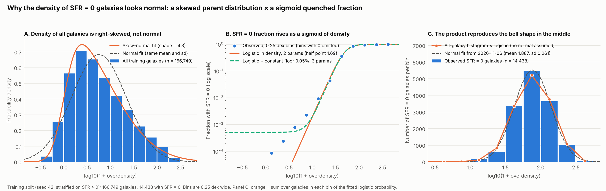
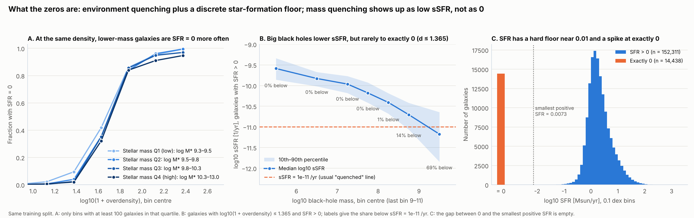

# 2026년 11월 7일 정규분포 관찰의 이론 검토

[어제 정리](2026-11-06_밀도와_SFR_실험정리.md)의 출발점은 **SFR=0인 은하의 주변 밀도 분포가 중심부에서 정규분포와 비슷하다**는 관찰이었다. 오늘은 그 관찰을 "시뮬레이션이 정규분포에서 뽑은 값이라서 그런가"라는 질문으로 바꾸고, 밀도장 이론과 은하 퀜칭 이론에서 예측을 끌어내어 같은 학습 분할에서 확인했다.

결론은 다음과 같다.

- **정규분포는 뽑은 것이 아니라 만들어진 모양이다.** 전체 은하의 밀도 분포는 오른쪽으로 치우쳐 있고(왜도 +0.54), SFR=0 비율은 밀도의 시그모이드다. 치우친 분포의 오른쪽 내리막에 올라가는 시그모이드를 곱하면 가운데가 종 모양인 분포가 나온다. 정규분포를 가정하지 않은 "전체 히스토그램 × 2모수 로지스틱"이 중간 구간의 왜도 0.02, 초과첨도 −0.60을 주며, 관측(0.16, −0.44)과 절단정규 기준(0, −0.63) 사이에 있다.
- 시뮬레이션에서 난수가 들어가는 곳은 z = 39의 초기 밀도 요동뿐이고, 그것도 진폭을 고정하고 위상만 무작위로 둔 "phase-fixing" 가우시안장이다(Oku & Nagamine 2024에서 확인). 은하의 밀도·SFR은 중력과 가스 물리, 별 생성 처방에서 나온 결과이며, 값을 분포에서 추출한 흔적은 없다.
- **SFR=0은 이산적인 상태다.** 양수 SFR의 최솟값은 0.0073이고 0.01 아래는 2개뿐인데 정확히 0은 14,438개다. 시뮬레이션 처방(문턱 n_H = 0.1 cm⁻³, 효율 0.01, 가스 입자 1.01×10⁸ h⁻¹ M☉)으로 계산한 "문턱 밀도의 가스 입자 하나"의 SFR이 0.0071 h⁻¹ M☉/yr다. 0은 별 생성 가스 입자가 하나도 없는 상태다.
- **질량 퀜칭(블랙홀)은 0이 아니라 낮은 sSFR로 나타난다.** 낮은 밀도에서 블랙홀 질량 10⁹ 이상인 은하의 68.5%가 sSFR < 10⁻¹¹/yr이지만, 같은 집단에서 SFR이 정확히 0인 비율은 2.9%다. 그래서 0/양수 분류는 환경 퀜칭을, 양수 회귀는 질량 퀜칭을 담당한다. 어제 permutation importance에서 분류기가 밀도에, 회귀기가 블랙홀·항성 질량에 기댄 이유다.
- **Peng 외 2010의 분리 가설은 이 데이터에서 기각된다.** 같은 밀도에서는 **질량이 작은 은하가 더 자주 0**이라서, 질량이 퀜칭을 늘리기만 하는 Peng의 곱 구조로는 표현되지 않는다. 로짓 가법 구조가 더 낫지만 그것도 상호작용을 남긴다.

아래 수치는 모두 학습 분할(166,749개, SFR=0 14,438개, `random_state=42`, 양수 여부로 층화) 기준이며 탐색 결과다. 그림 글자는 한글 글꼴이 없는 환경에서 그려서 영어다.

## 데이터의 출처: CROCODILE 시뮬레이션

제공 데이터는 CROCODILE 시뮬레이션에서 나왔다. 공식 사이트와 논문 세 편(방법론 논문 Oku & Nagamine 2024, L200 상자를 쓴 Kuwayama 외 2026, CAMELS-CROCODILE Nagamine 외 2026)에서 확인한 사실은 다음과 같다.

| 항목 | 논문에서 확인한 값 | 데이터에서 보이는 것 |
|---|---|---|
| 코드 | GADGET4-Osaka (GADGET-4 기반 TreePM + 압력-에너지 SPH) | – |
| 상자·입자 (L200N1024) | 한 변 200 h⁻¹ cMpc 주기 상자, 암흑물질 1024³ + 가스 1024³, m_DM = 5.39×10⁸, m_gas = 1.01×10⁸ h⁻¹ M☉ | 위치 범위 0.000~199.9999 → 같은 상자, 단위 h⁻¹ cMpc |
| 초기 조건 | MUSIC2-monofonIC, z_ini = 39, 3LPT, CLASS 전달함수, Planck 2018 우주론. 우주 분산을 줄이는 phase-fixing(진폭 고정, 위상 무작위) 사용 | – |
| 별 생성 | n_H > 0.1 cm⁻³, T < 10⁴ K인 가스 입자에 국소 Schmidt 법칙 ρ̇* = ε* ρ/t_ff, ε* = 0.01. 별 입자는 확률적으로 생성(입자당 최대 2개) | 최소 양수 SFR 0.0073; 문턱 밀도 가스 입자 하나의 SFR 추정 0.0071 h⁻¹ M☉/yr |
| 블랙홀 | FoF 헤일로 질량 10¹⁰ h⁻¹ M☉ 이상에 씨앗 10⁵ h⁻¹ M☉를 심음. Bondi 강착(Eddington 제한, 일부 run은 제한 없음·부스트 50), AGN은 확률적 열 에너지 주입(ε_r = 0.1, ε_f = 0.15) | BH 질량 최솟값 정확히 10^5.0, 전체의 6.8%가 그 값 |
| 냉각·피드백 | Grackle 냉각 + Haardt & Madau UVB, Osaka 모형 II 초신성(확률적 열 + 역학적 운동량), TIGRESS 기반 바람, CELib 12원소 | – |
| 헤일로 | FoF + Subfind | `subhalo_id` |

Kuwayama 외 2026은 같은 L200 상자에서 셀 단위 개수 분포가 **두꺼운 꼬리를 가진 비가우시안**이며 가우시안 가정이 극단값의 희귀도를 크게 과대평가한다고 보고하고, 비대칭 일반화 정규분포로 적합했다. 시뮬레이션 제작진 자신이 밀도 통계를 정규로 두지 않는다는 뜻이다.

확인하지 못한 것: 데이터가 어느 변형 run(피드백 조합)인지, 밀도(overdensity)의 측정 반경, `sfr_linear`가 가스 입자의 순간 SFR 합인지 별 입자 기반 시간 평균인지. 0과 0.0073 사이가 비어 있고 질량에 무관한 바닥값이 있는 것은 순간 SFR 합 쪽을 가리킨다.

## 검토한 이론과 판정

| 이론 | 데이터에서 기대하는 것 | 확인한 것 | 판정 |
|---|---|---|---|
| 초기 조건은 가우시안 랜덤장 | 정규분포가 "들어가는" 곳은 초기 밀도 요동뿐 | 논문 확인: MUSIC2-monofonIC, z = 39, 3LPT, phase-fixing. 은하 속성은 물리 출력(SFR 바닥값, 씨앗 BH, 상자 좌표) | 확인됨, 은하 속성과는 무관 |
| 비선형 밀도장의 로그정규 근사 (Coles & Jones 1991) | log10(1+δ)가 정규에 가깝다 | 은하 위치에서 본 분포는 왜도 +0.54, 왜정규가 정규보다 AIC 16,131 낫다. 제작진도 같은 상자의 밀도 통계를 비가우시안으로 보고 | 변수 변환의 근거는 되지만 은하 가중 분포는 정규가 아님 |
| 환경 퀜칭 (위성 은하의 가스 박탈, Gunn & Gott 1972; Larson 외 1980; Wetzel 외 2013) | SFR=0 비율이 밀도의 단조 시그모이드 | 2모수 로지스틱이 14구간 계단 모형보다 AIC가 낮음, 반값 밀도 1.69 (1+δ ≈ 49) | 지지 |
| 치우친 분포 × 시그모이드 = 가운데 종 모양 (Azzalini의 왜정규 계열) | 정규 가정 없이 중간 구간의 종 모양이 재현 | 중간 구간 왜도 0.02, 첨도 −0.60 (관측 0.16, −0.44) | **지지: 어제 관찰의 설명** |
| 질량 퀜칭이 SFR=0을 만든다 (Peng 외 2010의 ε_m) | 낮은 밀도에서 무거운 은하일수록 0 비율 상승 | 항성 질량 9~12 전 구간에서 0.2~0.5%, Peng 적합의 ε_m ≈ 0 | 기각 (0으로는 나타나지 않음) |
| 질량 퀜칭은 낮은 sSFR로 나타난다 | 블랙홀이 클수록 sSFR 하락 | BH 10⁹ 이상: sSFR 중앙값 10^−11.17, 68.5%가 −11 아래 | 지지 |
| Peng의 분리 가설 (1−f) = (1−ε_m)(1−ε_ρ) | 질량·밀도 효과가 곱으로 분리 | G² = 447.5 (df 37), 부호도 반대 | 기각 |
| 로짓 가법 구조 logit f = a(m) + b(d) | 어제의 offset 구조가 전제하는 형태 | G² = 221.1 (df 37), Peng보다 AIC 226 낮음 | 부분 지지, 상호작용 남음 |
| SFR=0은 별 생성 문턱 아래 상태 (Oku & Nagamine 2024: n_H > 0.1 cm⁻³, ε* = 0.01) | 0과 최소 양수 사이에 빈 틈, 바닥값 ≈ 입자 하나의 SFR | 최소 양수 0.0073 대 입자 하나 추정 0.0071 h⁻¹ M☉/yr, 0.01 아래 2개, 정확히 0은 14,438개 | 지지 |
| 유한 상자와 소수의 은하단 | 최고 밀도 꼬리가 짧게 잘림 | 밀도 > 2.25인 1,147개가 13개 덩어리, 최고 구간 74개 중 73개가 0 | 지지 |
| 램 압력 ∝ ρ v² | 같은 밀도에서 빠른 은하가 더 자주 0 | 중간 구간 속력 AUC 0.674, 로지스틱 AIC −52 | 약한 지지 (상자 기준 속도라 은하단 소속의 대리 변수) |

## 상세

### 전체 은하의 밀도 분포

로그정규 모형은 밀도장을 부피로 가중해 본 분포에 대한 근사다. 우리 데이터는 은하 위치에서 본 밀도이므로 무거운 헤일로 쪽으로 가중되고, 그 결과 오른쪽으로 치우친다.

| 통계 | 값 |
|---|---:|
| 평균 | 0.754 |
| 표준편차 | 0.584 |
| 왜도 | +0.536 |
| 초과첨도 | −0.356 |
| 정규 AIC | 293,908 |
| 왜정규 AIC (형태 모수 4.31) | 277,777 |

양 끝은 두 모형 모두 놓친다. 최저 구간 (−0.75, −0.5]의 관측 14개를 정규는 1,816개, 왜정규는 83개로 예측하고, 최고 구간 (2.5, 2.75]의 관측 74개를 정규는 180개, 왜정규는 782개로 예측한다. 최고 밀도 쪽은 상자 안에 있는 은하단 수로 잘린다(아래 참고).

### 퀜칭 비율과 곱

베이즈 항등식으로 SFR=0 은하의 밀도 분포는 다음과 같다.

$$
p(d \mid \mathrm{SFR}=0)=\frac{f_q(d)\,p(d)}{P(\mathrm{SFR}=0)}.
$$

p(d)를 관측 히스토그램 그대로 두고 f_q(d)만 모수 모형으로 적합했다.

| f_q 모형 | 모수 | AIC | 반값 밀도 | 구간 χ² | 모형이 말하는 0 은하 밀도의 (왜도, 첨도) | 중간 구간만 |
|---|---:|---:|---:|---:|---|---|
| 14구간 계단(포화) | 14 | 27,831 | – | 0 | 관측과 같음 (−0.51, 2.04) | (0.16, −0.44) |
| 로지스틱 | 2 | 26,151 | 1.694 | 173.6 | (−0.15, 0.12) | (0.02, −0.60) |
| probit | 2 | 27,330 | 1.701 | 321.6 | (−0.07, −0.27) | (0.01, −0.69) |
| 로지스틱 + 바닥 | 3 | 26,015 | 1.694 | 132.1 | (−0.76, 3.79) | (0.03, −0.58) |
| 로지스틱 + 바닥 + 천장 | 4 | 25,550 | 1.665 | 294.3 | (−1.29, 7.32) | (0.12, −0.55) |

2모수 로지스틱만으로 밀도 1.5 이상 다섯 구간의 0 개수를 5% 안에서 맞춘다(관측 3,361·5,480·3,649·1,042·73 대 예측 3,359·5,197·3,773·1,070·74). 중간 구간 (L, U]의 모양도 정규에 가깝게 나온다. 즉 **어제 본 종 모양은 정규분포를 가정하지 않아도 나온다**.

반면 전체 범위의 왜도 −0.51과 첨도 2.04는 꼬리가 만든다. 낮은 쪽 꼬리는 로지스틱이 크게 놓치고(밀도 0.5~1.0의 관측 71개 대 예측 18개), 바닥 모수를 더하면 꼬리는 맞지만 (1.25, 1.5] 구간을 여전히 과대예측한다(관측 591 대 예측 753). 천장 모수(94.85%)는 AIC를 더 낮추지만 구간 χ²는 나빠지고 최고 밀도 쪽을 과소예측한다. 어느 매끈한 2~4모수 함수도 양 끝을 동시에 맞추지 못하므로, 양 끝에는 환경 퀜칭 시그모이드 외의 것이 있다.

SFR=0 은하의 밀도에 정규와 왜정규를 직접 적합하면 왜정규가 AIC 299 낫고(형태 모수 −1.33, 왼쪽 꼬리), 중간 구간만 잘라서 적합하면 왜정규가 66 낫다(형태 모수 +1.32). 다만 잘린 표본에 절단하지 않은 분포를 적합한 비교이므로 중간 구간 값은 참고만 한다.



### 질량의 역할

항성 질량 4분위(경계 10^9.3, 9.5, 9.8, 10.3, 13.0) × 밀도 14구간의 54개 셀에서 SFR=0 비율을 봤다.

| 밀도 구간 | Q1 (낮음) | Q2 | Q3 | Q4 (높음) |
|---|---:|---:|---:|---:|
| (1.25, 1.5] | 9.5% | 4.0% | 2.4% | 2.0% |
| (1.5, 1.75] | 41.9% | 35.4% | 35.1% | 32.1% |
| (1.75, 2.0] | 86.0% | 83.8% | 85.6% | 84.0% |
| (2.25, 2.5] | 99.5% | 99.5% | 97.0% | 94.7% |

같은 밀도에서 **가벼운 은하가 더 자주 0**이다. 가벼운 위성 은하가 가스를 더 쉽게 잃는다는 위성 퀜칭 그림과 맞고, 무거울수록 퀜칭이 늘어난다는 Peng의 질량 퀜칭과는 반대다. SFR=0 은하의 밀도 평균도 Q1 1.821에서 Q4 1.919로 올라가고 표준편차는 0.295에서 0.245로 줄어든다. 어제 남긴 질문 "질량별로 나눠도 정규 모양이 유지되는가"의 답은 **모양은 유지되고 중심과 폭이 질량에 따라 움직인다**이다.

| 셀 모형 | 모수 | AIC | 포화 대비 G² (df 37) | p |
|---|---:|---:|---:|---:|
| 포화(54셀) | 54 | 27,451 | 0 | – |
| 로짓 가법 logit f = a(m) + b(d) | 17 | 27,598 | 221.1 | 4×10⁻²⁸ |
| Peng 곱 (1−f) = (1−ε_m)(1−ε_ρ) | 17 | 27,824 | 447.5 | 6×10⁻⁷² |

Peng 적합의 ε_m은 네 분위 모두 0.001 이하다. 표본이 16만 개라 작은 이탈도 유의하므로 G²의 p값보다 두 모형의 AIC 차이(226)와 부호에 주목한다.

### 낮은 밀도의 0 은하 435개

어제 "질량·블랙홀·병합에서 어떻게 다른가"를 물었던 집단이다. 질량 퀜칭된 거대 은하가 아니었다.

| 집단 | n | 항성 질량 중앙값 | 헤일로 질량 중앙값 | BH가 씨앗값(10^5)인 비율 | 헤일로 < 항성 비율 |
|---|---:|---:|---:|---:|---:|
| 낮은 밀도, SFR=0 | 435 | 9.54 | 10.51 | 37.9% | 7.4% |
| 낮은 밀도, SFR>0 | 138,493 | 9.82 | 11.43 | 4.9% | 0.1% |
| 중간 밀도, SFR=0 | 13,702 | 9.93 | 10.92 | 19.5% | 1.0% |
| 중간 밀도, SFR>0 | 13,815 | 9.94 | 11.17 | 9.9% | 0.4% |

이들은 가볍고, 헤일로 질량이 같은 밀도의 양수 은하보다 거의 1 dex 작으며, 헤일로가 항성보다 가벼운(조석 박탈의 흔적) 비율이 50배 이상 높다(7.4% 대 0.13%). 밀도 측정 반경보다 작은 집단에 속한 위성이거나, 가스를 잃은 뒤 헤일로까지 깎인 천체로 보인다. 낮은 밀도에서 항성 질량별 0 비율은 0.38%(9~10), 0.16%(10~10.5), 0.25%, 0.30%, 0.47%(11.5~12)로 질량과 무관하고, 블랙홀 10⁹ 이상에서도 2.9%(314개 중 9개)다.

같은 낮은 밀도의 양수 은하에서 sSFR을 보면 질량 퀜칭은 분명히 있다.

| 블랙홀 질량 | n | log10 sSFR 중앙값 | sSFR < 10⁻¹¹ 비율 |
|---|---:|---:|---:|
| (5, 6] | 132,673 | −9.59 | 0.1% |
| (7.5, 8] | 852 | −10.18 | 0.1% |
| (8, 8.5] | 935 | −10.41 | 1.3% |
| (8.5, 9] | 701 | −10.70 | 13.6% |
| (9, 11] | 305 | −11.17 | 68.5% |

즉 이 시뮬레이션의 AGN 피드백은 별 생성을 10분의 1 이하로 줄이지만 가스를 완전히 없애지는 않는다. "0인가"는 환경, "얼마나 작은가"는 질량이 정한다.



### SFR=0의 정의

| 통계 (학습 양수 152,311개) | 값 |
|---|---:|
| 최소 양수 SFR | 0.0073 |
| 0.1% 분위수 | 0.075 |
| 1% 분위수 | 0.29 |
| 0.01 아래 개수 | 2 |
| 0.1 아래 개수 | 255 |
| 정확히 0 | 14,438 |

항성 질량 구간별 최소 양수 SFR은 0.008~0.015로 질량과 무관하다. 방법론 논문의 처방으로 문턱 밀도에 있는 가스 입자 하나의 SFR을 계산하면 다음과 같다.

$$
\dot m_* = \epsilon_* \frac{m_{\rm gas}}{t_{\rm ff}},\qquad
t_{\rm ff}=\sqrt{\frac{3\pi}{32 G \rho}},\quad
\rho = \frac{n_{\rm H} m_p}{X_{\rm H}}.
$$

n_H = 0.1 cm⁻³, X_H = 0.76이면 t_ff ≈ 1.4×10⁸ yr이고, ε* = 0.01, m_gas = 1.01×10⁸ h⁻¹ M☉이면 **0.0071 h⁻¹ M☉/yr**(h = 0.677로 환산하면 0.0105 M☉/yr)다. 데이터의 최소 양수 SFR 0.0073과 같은 자릿수이며, 단위 규약을 모르는 상태에서 기대할 수 있는 가장 좋은 일치다. 0은 연속 분포의 왼쪽 끝이 아니라 "문턱을 넘는 가스 입자가 없음"이라는 별개의 상태이고, 어제처럼 0 여부를 분류 문제로 다루는 것이 자료의 생성 과정과 맞다.

### 상자 크기와 꼬리

- 밀도 최댓값은 2.512(1+δ ≈ 325)이고, 밀도 > 2.25인 학습 은하 1,147개는 서로 2 h⁻¹ Mpc 안에 이어진 덩어리 **13개**에 들어 있다. 200 h⁻¹ Mpc 상자에 있는 가장 무거운 은하단 수가 밀도 상한을 정한다. 이것이 Q–Q 그래프 오른쪽 끝이 짧은 이유다.
- 최고 두 구간에서 0의 비율은 97.1%, 98.6%다. SFR=0 은하 밀도의 오른쪽 꼬리는 사실상 전체 은하의 오른쪽 꼬리 그 자체다.
- 속력(상자 기준) 중앙값은 낮은 밀도 429, 중간 밀도 양수 685, 중간 밀도 0 932, 높은 밀도 1,668이다. 중간 구간에서 속력 하나로 0을 가르는 AUC는 0.674, 로지스틱에 log 속력을 더하면 AIC가 52 낮아진다. 호스트 기준 상대 속도가 아니므로 램 압력의 직접 증거라기보다 "무거운 헤일로 안에 있음"의 대리 변수다. 어제 전체 모델에서 위치·속도 6열을 빼도 동등했던 결과와 모순되지 않는다.

## "정규분포에서 뽑았나"에 대한 답

시뮬레이션에서 난수로 뽑는 것은 z = 39의 초기 밀도 요동뿐이고, 그것도 진폭을 고정하고 위상만 무작위로 둔 phase-fixing 가우시안장이다(Angulo & Pontzen 2016 방식). z = 0의 은하 밀도·질량·SFR은 중력·유체·별 생성·피드백 처방의 결정론적 출력이다. 어제 본 종 모양은 (1) 은하 가중 밀도 분포가 오른쪽으로 길게 내려가고, (2) 환경 퀜칭 비율이 그 내리막 위에서 0에서 1로 올라가며, (3) 두 함수의 곱이 가운데에서 종 모양을 만들기 때문이다. 정규 "같은" 것은 맞지만 정규 "에서 나온" 것은 아니며, 양 끝(가벼운 박탈 위성의 왼쪽 꼬리, 은하단 수로 잘린 오른쪽 꼬리)이 정규에서 벗어나는 이유도 각각 따로 있다.

데이터 작성자가 추출 뒤에 값을 가공했을 가능성(밀도 측정 반경, 질량 하한 10^9.3 선택, SFR 단위)은 데이터 설명에 없어 닫지 못했다. 다만 바닥값·씨앗값·상자 좌표가 모두 처방과 맞으므로 값 자체를 바꾼 흔적은 없다.

## 모델에 주는 시사점

1. **q_G의 절단정규는 법칙이 아니라 근사다.** 같은 역할을 2모수 로지스틱 f_q(d)가 더 적은 모수로 한다. 어제 정규 가정을 풀어도 성능이 같았던 결과와 일관된다. 보조 확률을 만든다면 로지스틱이 이론 모양과 맞고 설명하기도 쉽다.
2. **offset 구조 logit p₀ = logit q(d) + h(Z)는 로짓 가법 모형이다.** Peng 곱 구조보다는 낫지만 질량 × 밀도 상호작용(가벼운 은하의 전환 밀도가 낮음)이 남는다. h(Z)에 질량과 밀도의 상호작용을 넣거나, 전체 피처 HGB가 이미 그 상호작용을 학습한다고 보는 것이 맞다. 어제 보조 확률이 성능을 더하지 못한 이유가 여기 있다.
3. **0은 가스 상실 상태이므로 가스 상실의 대리 피처가 후보다.** 헤일로 질량 − 항성 질량(조석 박탈 정도), 헤일로 < 항성 여부, 씨앗 블랙홀 여부. 특히 낮은 밀도의 0 은하 435개는 이 피처로만 구분될 가능성이 있고, 11절 오류 분석의 "낮은 밀도 거짓 양수" 항목이 된다.
4. **양수 회귀는 sSFR 척도가 자연스럽다.** 질량 퀜칭이 sSFR의 하락으로 나타나므로, log SFR − log M*를 타깃으로 두고 블랙홀·항성 질량으로 설명하는 구조를 7절 후보에 넣을 수 있다. 다만 최종 평가는 원래 척도 RMSE이므로 되돌림 편향(어제 log1p 결과)을 다시 확인해야 한다.
5. **12절(천체물리 해석)의 뼈대**: 0/양수는 환경(위성) 퀜칭, 양수의 크기는 질량(AGN) 퀜칭, 최고 밀도 꼬리는 상자 안 은하단 13개, 최소 SFR 바닥은 가스 입자 해상도.

오늘은 제출 노트북과 `FINAL_MODEL`을 바꾸지 않았다.

## 코드와 재실행

저장소 루트에서 실행한다. 요구 패키지는 [requirements_2026-11-06.txt](requirements_2026-11-06.txt)와 같고 pandas를 추가로 쓴다. 두 스크립트 합쳐 약 15초 걸린다.

```bash
python work/조장/theory_check_2026-11-07/theory_checks.py
python work/조장/theory_check_2026-11-07/plot_theory_checks.py
```

| 파일 | 역할 |
|---|---|
| [theory_checks.py](theory_check_2026-11-07/theory_checks.py) | A~H 절의 모든 수치 계산, 요약 출력 |
| [theory_check_results.json](theory_check_2026-11-07/theory_check_results.json) | 원수치(모멘트, 적합 모수, 셀 표, 분위수) |
| [plot_theory_checks.py](theory_check_2026-11-07/plot_theory_checks.py) | 그림 1·2 (PNG·SVG) |

## 참고 문헌

- Coles & Jones 1991, MNRAS 248, 1 — 밀도장의 로그정규 모형 ([ADS](https://ui.adsabs.harvard.edu/abs/1991MNRAS.248....1C))
- Kayo, Taruya & Suto 2001 — 가우시안 초기 조건에서 진화한 밀도 PDF와 로그정규 비교 ([arXiv:astro-ph/0105218](https://arxiv.org/abs/astro-ph/0105218))
- Azzalini 1985 — 왜정규분포 φ(x)Φ(αx) ([개요](https://en.wikipedia.org/wiki/Skew_normal_distribution))
- Gunn & Gott 1972 — 램 압력 박탈 ([ADS](https://ui.adsabs.harvard.edu/abs/1972ApJ...176....1G)); Larson, Tinsley & Caldwell 1980 — 가스 공급 차단(strangulation) ([ADS](https://ui.adsabs.harvard.edu/abs/1980ApJ...237..692L))
- Peng 외 2010 — 질량 퀜칭과 환경 퀜칭의 분리 ([arXiv:1003.4747](https://arxiv.org/abs/1003.4747))
- Wetzel 외 2013 — 위성 은하 퀜칭의 지연 뒤 급속 모형 ([arXiv:1206.3571](https://arxiv.org/abs/1206.3571))
- Springel & Hernquist 2003 — 문턱 밀도와 Schmidt 법칙으로 SFR을 주는 다상 ISM 처방 ([arXiv:astro-ph/0206393](https://arxiv.org/abs/astro-ph/0206393))
- Oku & Nagamine 2024, ApJ 975, 183 — "Osaka Feedback Model III: Cosmological Simulation CROCODILE", 처방 전체(초기 조건, 별 생성 법칙과 문턱, 블랙홀 씨앗, 피드백) ([arXiv:2401.06324](https://arxiv.org/abs/2401.06324))
- Kuwayama 외 2026 — L200N1024 상자 설정과 셀 개수 분포의 비가우시안성 ([arXiv:2512.24966](https://arxiv.org/abs/2512.24966))
- Nagamine 외 2026 — CAMELS-CROCODILE, Osaka 모형의 기준 모수표 ([arXiv:2609.23982](https://arxiv.org/abs/2609.23982))
- Angulo & Pontzen 2016 — 진폭 고정(phase-fixing) 초기 조건 ([arXiv:1603.05253](https://arxiv.org/abs/1603.05253))
- CROCODILE 공식 사이트: https://sites.google.com/view/crocodilesimulation/home
