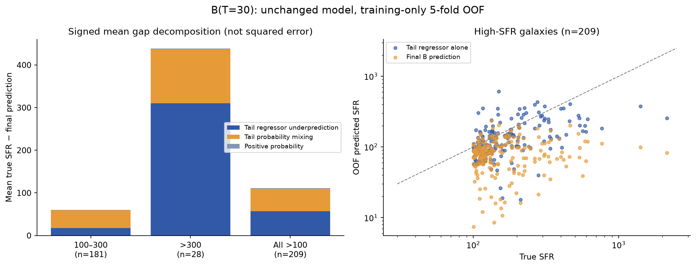

# B(T=30) 꼬리 예측 진단 — 2026-11-11

**결론: 큰 SFR의 과소예측은 꼬리 회귀기와 꼬리 확률 양쪽에서 발생한다. 0/양수 분류의 영향은 작다.**

저장소 `ZizonK7/sdi2026-galaxy-sfr`, main 커밋 `fef00ffaf2992104c8d6dc0e87ab0b30275d8c9d`의 `work/팀원/james_tail.ipynb`에서 모델 클래스를 그대로 가져왔다. 데이터의 Git blob SHA까지 원본과 일치한다. 원래 80:20 분할의 학습 166,749개만 사용해 동일한 5-fold OOF 예측을 생성했다. 검증셋을 평가하거나 모델을 변경하지 않았다.

기존 2단계 OOF RMSE **9.126032**, B(T=30) **8.798251**로 저장된 결과가 소수점 셋째 자리까지 재현됐다.

## 큰 SFR 은하에서 예측이 낮아지는 단계

| 실제 구간 | 수 | 실제 SFR 평균 | 꼬리 회귀기 출력 평균 | 최종 B 예측 평균 | 평균 꼬리 확률 |
|---|---:|---:|---:|---:|---:|
| 100 < SFR ≤ 300 | 181 | 145.66 | 127.76 | 85.50 | 73.50% |
| SFR > 300 | 28 | 531.06 | 221.26 | 92.70 | 43.02% |
| SFR > 100 전체 | 209 | 197.29 | 140.29 | 86.46 | 69.41% |

꼬리 확률은 `P(SFR>30 | SFR>0, X)`다. 꼬리 회귀기 출력과 확률은 행별로 결합하므로 평균값끼리 단순히 곱하면 최종 평균과 일치하지 않는다.

## 평균 과소예측의 정확한 분해

`p = P(SFR>0|X)`, `q = P(SFR>30|SFR>0,X)`, `e_t = 꼬리 회귀 출력`, `e_m = 보통 회귀 출력`으로 두면:

`y − prediction = (y − e_t) + (1−p)e_t + p(1−q)(e_t−e_m)`

| 실제 구간 | 회귀기 자체 차이 | 꼬리 확률 혼합으로 감소 | 0/양수 확률로 감소 | 총 평균 과소예측 |
|---|---:|---:|---:|---:|
| 100 < SFR ≤ 300 | 17.90 | 41.29 | 0.98 | 60.17 |
| SFR > 300 | 309.80 | 127.57 | 0.99 | 438.36 |
| SFR > 100 전체 | 57.01 | 52.85 | 0.98 | 110.83 |

SFR>100 전체의 평균 과소예측에서 회귀기 차이는 약 **51.4%**, 꼬리 혼합 감소는 **47.7%**, 0/양수 확률 감소는 **0.9%**다. 이는 **부호 있는 평균 잔차의 대수적 분해**이며, 오차제곱합의 비중이나 인과 기여율이 아니다. 확률 감소 항의 배분은 위 식의 기준에 따른다.

100~300에서는 확률 혼합으로 낮아지는 양이 회귀기 자체 차이보다 크다. 300 초과에서는 회귀기의 과소예측이 더 크지만, 꼬리 확률도 예측을 상당히 낮춘다. 300 초과 28개 중 **19개**에서 꼬리 확률이 0.5 미만이다.

## 실제 모델 성능과 구분한 진단

OOF에서 분류 확률 대신 실제 구간 정답을 넣는 비현실적 비교도 했다. 이것은 실제로 제출할 수 있는 모델이나 달성 가능한 성능의 보장이 아니다.

| 진단 조건 | 전체 RMSE |
|---|---:|
| 실제 B | 8.798 |
| 0/양수 구분만 정답으로 교체 | 8.787 |
| 보통/꼬리 구분만 정답으로 교체 | 7.668 |
| 두 구분 모두 정답으로 교체 | 7.697 |

0/양수 구분을 바꾸는 효과보다 보통/꼬리 구분을 바꾸는 효과가 크다. 두 구분을 모두 정답으로 바꿔도 더 좋아지지 않는 것은 회귀 출력과 확률 오차가 서로 상쇄할 수도 있음을 보여준다. 이 진단 수치를 개선 가능성의 상한/하한으로 해석하지 않는다.

## 다음 실험에 대한 판단

1. 꼬리 분류 AUC가 전체 양수 집단에서 약 0.996이어도 극단 SFR에서 확률이 적절하다는 뜻은 아니다. 먼저 큰 SFR인데 낮은 꼬리 확률을 받은 행을 분석한다.
2. 100~300 구간에는 꼬리 분류/확률 개선을 우선 검토하고, 300 초과에는 회귀기 개선을 병행한다. 확률을 일괄적으로 높이는 것은 보통 은하의 과대예측을 늘릴 수 있다.
3. SFR>300은 28개뿐이고 전체 B 오차제곱합의 약 72.85%를 차지한다. 다음 후보도 전체 OOF RMSE와 구간별 부작용을 함께 비교해야 한다.

## 재현과 파일

`python -m pip install -r requirements.txt`

`python run_diagnosis.py --data "Galaxy Features with Position and Velocity for Star Formation Rate Prediction.csv" --out rerun_results`

- `diagnosis_view.ipynb`: 저장된 OOF 예측을 읽어 진단을 확인하는 노트북. 재학습은 위 스크립트로 수행한다.
- `segment_diagnosis.csv`: 구간별 수치와 분해.
- `high_sfr_209_rows.csv`: 큰 SFR 209개 행의 예측 구성요소, 원자료 행 인덱스, ID.
- `fold_metrics.csv`: fold별 성능과 학습 트리 수.
- `oof_components.npz`: 모든 학습 행의 OOF 구성요소.
- `oracle_diagnostics_NOT_achievable.csv`: 정답 구간을 사용한 진단 전용 비교.
- `metadata.json`: 커밋, 데이터 해시, 환경과 검증 기록.

분석과 결과 파일은 로컬에 저장했다. GitHub 저장소는 수정하지 않았다. 기존에 후보 선택에 사용한 CV이므로 새로운 독립 성능 검증은 아니다.
